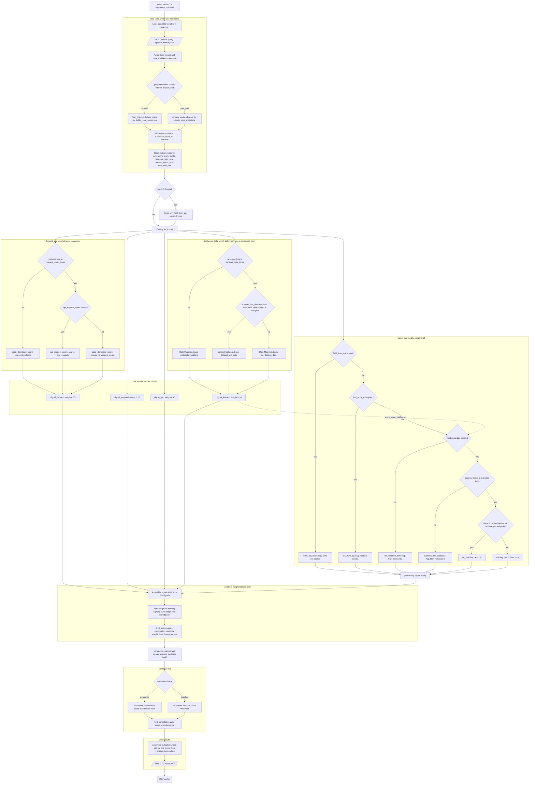

# HVD Pulse — `hvd_score.py`

Scores datasets on [data.gov.in](https://www.data.gov.in) for **High Value Dataset**
candidacy, and checks whether each one is actually being refreshed at the cadence
it publicly declares.

Designed to run **monthly on the portal's own server**, where modification dates
are live. It is stateless: no snapshot ledger, no cadence table, no score
history. Each run is a pure function of the table it reads, so running it twice
produces the same CSV twice.

It reads read-only and writes **one CSV**. It never writes the portal's
`High Value Dataset Category` field — flipping that is a human publishing
decision made *from* the CSV, not by the scorer.

---

## Quick start

```bash
# score every row of dublin_core_remaining (default --db works from any directory)
python hvd_scoring/hvd_score.py

# against Postgres, credentials from the environment
HVD_PG_DSN='postgresql://user:pw@host/db?sslmode=require' \
  python hvd_scoring/hvd_score.py --db pg --table postgres

# the other supported table
python hvd_scoring/hvd_score.py --db <path> --table dublin_core_metadata

# smoke test on the first 1,000 rows (scores are normalised over just these)
python hvd_scoring/hvd_score.py --db <path> --limit 1000 --out /tmp/hvd_sample.csv

# production shape: only API-fed datasets, fixed threshold so the
# candidate count can genuinely move month to month
python hvd_scoring/hvd_score.py --db <path> --api-only \
    --cut-mode absolute --cut-value 0.42
```

---

## The score

```
hvd_score = 0.35·demand + 0.25·temporal + 0.15·geo
          + 0.10·liveness + 0.15·punctuality
```

| signal | weight | asks | source columns |
|---|--:|---|---|
| `demand` | 0.35 | is anyone using this? | `ogdp_download_count` *(or `api_request_count`)*, `ogdp_view_count`, `Date Created` |
| `temporal` | 0.25 | how many years does it span? | `Temporal Coverage` |
| `geo` | 0.15 | how much of India does it cover? | `Spatial Coverage`, `Title`, `Collection` |
| `liveness` | 0.10 | how stale is it, absolutely? | `Date Modified` *(or the data's own last date)* |
| `punctuality` | 0.15 | did it refresh inside its **own** declared period? | `Date Modified` *(same)*, `Accrual Periodicity`, `field_from_api` |

Every signal is normalised to `[0, 1]`.

The two italicised alternatives are the [resource-type rules](#resource-type-rules):
which column a row's `demand` and freshness read is decided per row by its
`Accrual Method` (the portal's `field_resource_type`).

### Missing ≠ zero

A signal that is unavailable for a row is `NaN`, and `combine()` **redistributes
its weight proportionally across the signals that are present**. A row with no
temporal coverage is not a row with *zero* temporal coverage — the metadata is
simply absent, and scoring it 0 would punish a dataset for a gap in its record
rather than for anything about the dataset.

Concretely, a row missing `temporal` and `punctuality` is scored:

```
        0.35·demand + 0.15·geo + 0.10·liveness
        ──────────────────────────────────────    (denominator 0.60)
                 0.35 + 0.15 + 0.10
```

which is the weighted mean over what is actually known. Two columns exist so
this never hides anything from a reviewer:

- **`n_signals`** — how many of the five the score rests on.
- **`signals_present`** — which ones, e.g. `demand+geo+liveness`.

Redistribution means a row with one saturated signal can score high on thin
evidence. That is intended, but it must be *visible*, so sort by
`n_signals` alongside `hvd_score` when reviewing candidates.

---

## The five signals

### `demand` — 0.35

Downloads and views **per month since publication**, log-damped, then min-maxed.

Rates rather than lifetime totals, because raw counts are age-biased: a 2014
dataset has had a decade to accumulate views that a 2025 dataset has not. The
`log1p` and the p99 winsorisation (`--clip-pct`) exist because the raw
distribution is brutally long-tailed — the top download count is roughly 360× the
median, and without damping a handful of viral datasets flatten everything else
to near zero.

The two facets are averaged; if only one is present, that one is used alone.

Age comes from **`Date Created`, not `Date Issued`**. `Date Issued` carries the
API's `published`, which is blank on 49,381 rows of `dublin_core_remaining`;
`Date Created` carries `created` and is populated on effectively every row.

The download facet is not always the download column — on the API-served
resource types it reads `api_request_count`. See
[resource-type rules](#resource-type-rules).

### `temporal` — 0.25

Span in years, parsed from `start:YYYY;end:YYYY`, log-transformed and min-maxed.

A single snapshot supports lookup; a multi-year series supports trend analysis.
The log is there because the analytical gain from 1 → 3 years is large and from
100 → 200 years is negligible.

Two things it guards against:

- **The literal string `None`** is a missing marker, not a zero-length span.
- **Implausible starts.** Starts before `--min-start-year` (default 1950) are
  treated as *missing*, not zero. They are parse artifacts — single-year AHS and
  HMIS surveys carrying `start:1910`. Left in, they scored `temporal ≈ 1.0` and
  made up 38% of the entire candidate set.

`temporal_flag` in the output says which case applied: `ok`, `no_date`, or
`implausible_start_pre_1950`.

### `geo` — 0.15

Fraction of India's 36 States/UTs the dataset spans. Three rules, later ones
overriding earlier:

1. **Per-Collection fraction** of distinct States/UTs the merge family spans —
   partial credit, so 28/36 beats 4/36.
2. **National but aggregate** — `Spatial Coverage` is bare `India`, not resolved
   per State/UT → **0.5**.
3. **State/UT-wise title** — a "State-wise" or "UT-wise" title reports one row
   per State/UT, so the dataset already spans all 36 → **1.0**.

A national row inside a partial-coverage collection is deliberately pinned to 0.5
rather than its collection fraction. `"District-wise"`, `"Crop-wise"` and similar
titles deliberately do **not** match rule 3.

### `liveness` — 0.10

`0.5 ** (days_since_modified / 365)` — exponential decay, so a year-old row
scores 0.5, two years 0.25, regardless of what the rest of the table looks like.

**Why decay and not min-max like the other three:** the age distribution is not
spread out. 92.5% of `dublin_core_remaining` was last modified 2+ years ago, so
min-max would hand almost the entire `[0,1]` range to distinctions *inside* the
stale bulk and crowd the live tail together at the top. Decay is absolute, so the
live rows separate cleanly and the stale bulk lands near zero on its own.

Rows dated after `--as-of` (clock skew, scoring against a past date, or data
that runs into the future) saturate at 1.0 rather than scoring above it.

`days_since_modified` is really *days since the freshness date*, and on the
external-link resource types that is the last date the **data** covers, not the
metadata's `Date Modified`. See [resource-type rules](#resource-type-rules).

### `punctuality` — 0.15

**The point of the monthly run.** Binary: did this dataset refresh inside its own
declared period?

```
expected     = max(cadence_days[declared_cadence], run_interval_days)
punctuality  = 1.0   if days_since_modified <= expected
             = 0.0   if days_since_modified >  expected
             = NaN   if the check does not apply
```

**Late is a hard 0, not NaN** — a monthly dataset that missed its month is real
evidence, not absent evidence. **Binary, not graded**, because `liveness` already
carries how-stale as a gradient; grading this too would just double-count it.

#### Which cadences are auditable

| declared | expected window | scored? |
|---|--:|---|
| Hourly, Daily, Weekly, Fortnightly, Monthly | 30 d | ✅ collapses to "updated this month?" |
| Quarterly | 91 d | ✅ |
| Half yearly, Biannual | 183 d | ✅ |
| Annual | 365 d | ✅ |
| Biennial, Five Yearly, Decadal, One-time, Others, Irregular, *blank* | — | ❌ `NaN` |

A monthly job cannot resolve anything finer than one run interval, so every
sub-monthly cadence floors to the same window and the check reduces to exactly
the intended question: *was it updated this month or not.*

> ⚠️ `run_interval_days` is applied as a floor **after** the `cadence_days`
> lookup. Keep it equal to the sub-monthly entries — setting it higher silently
> overrides them.

#### Why not one cadence-relative half-life

The obvious design is to make the decay itself cadence-relative —
`0.5 ** (days / declared_period)` — one term instead of two. **It inverts the
score.** Against the real medians in `dublin_core_remaining`:

| declared | median days stale | cadence-relative decay |
|---|--:|--:|
| Decadal | 3,116 | **0.554** |
| Five Yearly | 1,716 | **0.521** |
| Annual | 1,715 | 0.039 |
| Quarterly | 1,444 | 0.000017 |
| Monthly | 1,716 | 6.0e-18 |
| Daily | 3,638 | **0.0** ← float underflow |

Defensible as *compliance* — a decadal table 8.5 years old genuinely is on
schedule — but compliance is not value, and the declared cadence is a **dropdown
the publisher controls**. At any meaningful weight, editing it to "Decadal" would
buy score for free, and 38% of the table already sits in that bucket. The Daily
row is also a literal bug: `0.5 ** 3638` underflows to exactly `0.0`, collapsing
every sub-monthly dataset to an identical hard zero regardless of behaviour.

With `NaN` outside the auditable cadences instead, declaring a lax cadence buys
only the **neutral** outcome — the row scores on its remaining signals, neither
rewarded nor punished — and a publisher who genuinely refreshes monthly can only
*lose* by declaring Decadal, because they forfeit a punctuality of 1.0. The
incentive points at declaring honestly.

#### The `field_from_api` gate

Punctuality only applies to datasets flagged as API-fed. A dataset nobody
promised to auto-refresh should not be marked down for not auto-refreshing;
those rows score `NaN` and their weight redistributes across the other four.

The gate is a **string** comparison, never a cast — the column is free-text
`VARCHAR` and casting to int throws on `''`. It accepts a small set of truthy
spellings rather than the literal `'1'` alone:

```python
api_true  = {"1", "true", "yes", "y", "t"}
api_blank = {"", "null", "none", "nan"}
```

matched lower-cased. This matters because the column is genuinely inconsistent
across this database — the aikosh tables carry the literal string `'NULL'`, and
`utils/kpi_calculator.py` expects `'TRUE'`/`'FALSE'`. A stricter `== '1'` test
would silently score every row `NaN` if the upstream backfill lands a different
spelling, and that output is indistinguishable from "this portal has no API
datasets".

`''`/`NULL` stays distinguishable from `'0'` so `from_api_blank` and
`not_from_api` remain separate flags while the backfill lands. Anything
unrecognised reads as `not_from_api` — we could not confirm it is API-fed.

#### `punctuality_flag` — never guess a 0 from a NaN

Every row gets exactly one, so a reviewer can always tell "missed its window"
from "check didn't apply":

| flag | `hvd_punctuality` | meaning |
|---|---|---|
| `on_time` | `1.0` | refreshed inside its declared period |
| `late` | `0.0` | missed it — real evidence |
| `not_from_api` | `NaN` | `field_from_api = '0'` |
| `from_api_blank` | `NaN` | `field_from_api` empty or NULL — unknown, not 0 |
| `cadence_not_auditable` | `NaN` | Decadal / One-time / Others / blank |
| `no_modified_date` | `NaN` | no parseable freshness date — no `Date Modified`, and (on the external-link types) no dataset end date to stand in for it. The flag keeps its old name for continuity with CSVs already produced |

---

## Resource-type rules

Two kinds of dataset are misread by the generic signals, so two inputs are
swapped per row based on the **resource type** — the portal's
`field_resource_type`, which the `dublin_core` tables carry as `Accrual Method`.
Both rules are narrow by design; type 1, a file the portal serves itself, is
scored exactly as before.

```python
request_count_types = {"6"}   # demand reads api_request_count, not downloads
dataset_date_types  = {"2"}   # freshness reads the data's own last date
```

### Type 6 → `demand` counts API requests

Type 6 is an API-served dataset — a dashboard or JSON feed. **Nobody downloads
it, it is polled**, so `ogdp_download_count` reads near-zero and `demand`
understates it structurally, not because it is unused. The download facet reads
`api_request_count` for these rows instead. Views are untouched.

| `demand_count_source` | meaning |
|---|---|
| `downloads` | the normal path |
| `api_requests` | a request-count type, and a request count was present — **`0` counts as `0`** |
| `no_request_count` | a request-count type whose `api_request_count` is `NULL`, or whose profile does not select the column — falls back to downloads |

> ⚠️ **One min-max, not one per source.** Both counters land on the same demand
> ladder — the whole point is that an API-served row becomes comparable to
> everything else, and a private ladder over a 36-row cohort would hand its top
> row a `1.0` for being the best of 36. The cost is that the two counters must be
> roughly commensurable: **if a live `api_request_count` arrives orders of
> magnitude above the download distribution, every row of those types saturates
> `demand`.** The run prints a `scale check` line with both distributions so this
> is visible before it distorts a ranking; if it does, normalising per source is
> a two-line change in `signal_demand`.

### Type 2 → freshness comes from the data, not the pointer

Type 2 is an **external link**: the portal row points at a file on the
publisher's own host. `Date Modified` therefore records edits to *the pointer*,
not refreshes of the data behind it — and on `dublin_core_remaining`, **35,277 of
36,316 type-2 rows carry a `Date Modified` newer than their own data, by a median
of 19 years.** Scored on `Date Modified`, a metadata touch reads as a refresh.

Both freshness terms — `liveness` **and** `punctuality` — are measured from the
last date the data covers instead, so punctuality asks "is this **data** inside
its declared period", not "was the pointer edited recently".

**Note the direction: these rows generally get *less* fresh, not more.** On the
baseline run 35,274 rows moved, 35,259 of them downward.

`dataset_last_date()` takes the most precise source available:

| # | source | note |
|--:|---|---|
| 1 | `data_end_raw` (the portal's `data_time_period_to`) | a real timestamp; populated on 35,330 of 36,316 type-2 rows |
| 2 | end of a `YYYY-MM-DD/YYYY-MM-DD` `Temporal Coverage` | already a full date, used as-is |
| 3 | end **year** of a `start:YYYY;end:YYYY` `Temporal Coverage` | read as **31 December** of that year |

Rule 3 is charitable by up to a year on purpose. It is what keeps the rule alive
on the year-granularity tables, and reading `end:2018` as 1 January would invent
a staleness the metadata never claimed. Ends before `--min-start-year` are
dropped as parse artifacts — the same guard `temporal` puts on starts — so a bad
parse falls back rather than scoring a row maximally stale.

| `freshness_basis` | meaning |
|---|---|
| `metadata_modified` | the normal path — `Date Modified` |
| `dataset_last_date` | a dataset-date type, and an end date resolved |
| `no_dataset_date` | a dataset-date type with no usable end date — falls back to `Date Modified`, because a stale date is still evidence |

### Switching a rule off

Both rules are driven by columns the profile selects, and all three are
**optional**. Unlike every other column in a profile, deleting one of these costs
no signal — it switches the rule off and the row scores the generic way:

| alias | needed for | delete it and… |
|---|---|---|
| `resource_type_raw` | both rules | **neither** rule can fire, whatever the other two say |
| `request_count_raw` | type 6 | every row scores `demand` on downloads |
| `data_end_raw` | type 2 | freshness falls back to rules 2–3 above, then `Date Modified` |

`dublin_core_remaining` has no `api_request_count`, so its 36 type-6 rows read
`no_request_count` and keep scoring on downloads. `dublin_core_metadata` has no
`data_time_period_to`, so a type-2 row there would resolve through the
`Temporal Coverage` end year — though every row on that table is currently
type 1, and neither rule changes its output at all.

---

## Flowchart

The path from `main()` to the written CSV. `signal_punctuality` is drawn in
full because its four `NaN` outcomes are the part most easily misread.



> The flag assignments in `signal_punctuality` are pandas mask overwrites,
> not an `if`/`elif` chain, so the **last write wins** and the source order is
> precedence *lowest*-first — the reverse of the tree above. The two are
> equivalent, but don't read the code top-to-bottom as a decision order.

---

## Configuration

The things at the top of the file, in the order you are likely to touch them:

| name | what it controls |
|---|---|
| `default_db` | DuckDB path, overridable by `$HVD_DB` or `--db` |
| `weights` | the five signal weights; must sum to 1.0 |
| `cadence_days` | declared cadence → allowed days without a refresh. **Anything not in this dict is not auditable and scores `NaN`** |
| `run_interval_days` | floor under every cadence; how often the job runs |
| `request_count_types` | resource types whose `demand` counts API requests instead of downloads |
| `dataset_date_types` | resource types whose freshness comes from the data's own last date instead of `Date Modified` |
| `tables` | per-table SQL and the `Temporal Coverage` encoding flag; the `postgres` entry is the editable template |
| `pg_dsn()` / `pg_aliases` | how Postgres credentials are read from the environment |

### Adding a cadence

Add it to `cadence_days`. Note the `NaN`-means-not-auditable behaviour is
load-bearing — `signal_punctuality` deliberately does **not** `fillna()` the
lookup, because that would silently convert every unauditable row into a scored
(mostly `late`) one.

### Running against Postgres

`--db pg` (or a `postgres://` URL, or `HVD_DB=pg`) switches the backend. It goes
through DuckDB's `postgres` extension — `ATTACH … (TYPE POSTGRES, READ_ONLY)` —
which is the same mechanism `transformation/setup_ducklake.py` already uses to
reach Neon. There is **no extra Python driver to install**, the SQL stays one
dialect, and `READ_ONLY` makes "this script never writes the database" true by
construction rather than by convention.

Two things to set, and neither of them is a code change to the scoring logic.

**1. Credentials — environment only, never in the file.**

```bash
# either a complete DSN/URL (use this for Neon: its connection string carries
# options the discrete vars below cannot express)
export HVD_PG_DSN='postgresql://user:pw@host/db?sslmode=require'   # or $DATABASE_URL

# or the standard libpq vars
export PGHOST=… PGPORT=5432 PGDATABASE=… PGUSER=… PGPASSWORD=…
export PGSCHEMA=reporting        # optional; defaults to public
```

Only the vars you actually set are emitted, so libpq's own defaults (`~/.pgpass`,
`$USER`) still cover the rest — a password never has to appear on a command line.
`sslmode` defaults to `require` and `connect_timeout` to 15s, so a blocked 5432
(a known hazard on this network) fails the run instead of hanging it. Every path
that prints a DSN runs it through `redact()` first, **including DuckDB's own
connection errors**, which otherwise echo the password into your logs.

**2. The column list — the `postgres` entry in `tables`.**

It ships as a template. Change the **left** side of each alias to your column
names; never the right side (`AS temporal_raw`, …) — those are the contract the
signal functions read. Set `"table"` to the real relation and `"schema"` if it is
not `public`; the profile name and the SQL relation name are free to differ.
Delete a line for a column you do not have: that signal then scores `NaN` and its
weight redistributes, which is the intended treatment of a missing signal.

Check your edit without connecting:

```bash
python hvd_scoring/hvd_score.py --db pg --table postgres --print-sql
```

#### Casts are not decoration

The signal code assumes every text-ish column arrives as a pandas `object`
column, because that is what DuckDB gives you. Postgres does not, and the profile
casts explicitly for three reasons — the first is a **silent** wrong answer:

| column type | uncast result |
|---|---|
| `field_from_api` as `boolean`/`integer` | `.str` yields all-`NaN` → the `api_true` test is False everywhere → **punctuality is `NaN` table-wide**, indistinguishable in the output from "this table has no API-fed datasets" |
| a real `date` inside `trim()` | no `trim(date)` in Postgres — the query errors out (loud, at least) |
| `timestamptz` | tz-aware datetimes vs. a tz-naive `as_of` → the date arithmetic raises |

`::TEXT` on a boolean gives `'true'`/`'false'`, both of which `api_true` /
`api_blank` already handle. `load()` also defensively coerces text columns and
strips tz, but the profile is where types should be pinned. Numeric counts are
safe uncast — `pd.to_numeric` handles `Decimal`.

### Running against some other database

`connect()` is still the only function that knows where the data lives. Point it
at another store — a different file, MotherDuck — and nothing below changes, as
long as the `tables` entry names columns that exist there.

### Adding a source table

Add an entry to `tables` with:

- `ministry_col` — for the `--ministry-departments` filter.
- `select` — SQL aliasing that table's columns onto the canonical names the
  signals expect. Do per-table cleanup here, not in the signals: e.g.
  `dublin_core_metadata` needs its `purl.org/cld/freq/` prefix stripped off
  `Accrual Periodicity` in SQL so the values match `cadence_days`.
- `temporal` — `"interval"` if `Temporal Coverage` is an ISO
  `YYYY-MM-DD/YYYY-MM-DD` range, `"start_end"` if it is already
  `start:YYYY;end:YYYY`.
- optionally `resource_type_raw`, `request_count_raw` and `data_end_raw` — the
  three columns the [resource-type rules](#resource-type-rules) read. Leave any
  of them out and that rule goes quiet; unlike the other columns, omitting one
  costs no signal.

> `from_interval()` derives the span from the interval's **duration**, not its
> year labels. Fiscal years are Apr–Mar here, so `2019-04-01/2020-03-31` is twelve
> months, but its labels say 2019..2020 — which naively reads as a two-year span,
> twice the depth of a calendar-year peer covering the same twelve months. 38% of
> intervals in `dublin_core_remaining` are affected.

---

## CLI

| flag | default | notes |
|---|---|---|
| `--db` | `$HVD_DB` or `<repo>/transformation/metadata.db` | a DuckDB path, or `pg` / a `postgres://` URL for Postgres. The default resolves from the repo root, so it works from any working directory; a relative path you pass resolves from the working directory as usual |
| `--table` | `dublin_core_remaining` | a profile name in `tables`: also `dublin_core_metadata`, `postgres` |
| `--print-sql` | off | print the SELECT and the resolved backend, then exit without connecting |
| `--out` | `<repo>/hvd_scoring/hvd_scores.csv` | gitignored — regenerable, ~45 MB. Default resolves from the repo root, like `--db` |
| `--as-of` | today | scoring date for all age calculations |
| `--ministry-departments` | all | exact match, space-separated, quote multi-word names |
| `--limit` | none | read at most N rows (SQL `LIMIT`, after `--ministry-departments`, before `--api-only`). For smoke tests only: every signal is normalised over the rows loaded, so scores are not comparable to a full run. The same rows come back each run on a DuckDB file; over Postgres that is not guaranteed |
| `--api-only` | off | score only `field_from_api = 1` rows |
| `--cut-mode` | `percentile` | `absolute` is the production setting |
| `--cut-value` | `10.0` | top N% in percentile mode, score threshold in absolute mode |
| `--clip-pct` | `99.0` | winsorise signal upper tails |
| `--half-life` | `365.0` | days after which `liveness` halves |
| `--min-start-year` | `1950` | temporal starts before this are unparseable; also the floor on a dataset's own end date |

### `--cut-mode absolute` is the production setting

A **percentile cut cannot move in aggregate**. If the entire portal went stale
next month, exactly 10% would still be candidates. For a score meant to change
dynamically month to month, freeze a threshold instead:

```bash
--cut-mode absolute --cut-value 0.42
```

The frozen value needs no stored state — it lives in the cron invocation. Derive
it once from a baseline run, then hold it.

> ⚠️ In percentile mode the cut is computed over the **rows actually loaded**, so
> `--api-only` and `--ministry-departments` both move it. Top 10% of the 957 API
> rows is `0.3463`; top 10% of the full table is `0.4042`.

---

## Output columns

34 columns, sorted by `hvd_score` then `n_signals`, both descending.

**Identity** — `nid`, `Title`, `Collection`, `ministry`, `resource_type`
**Demand inputs** — `downloads`, `views`, `api_requests`, `demand_count`, `demand_count_source`, `date_issued`, `months_since_issue`
**Freshness inputs** — `date_modified`, `date_dataset_end`, `date_freshness`, `freshness_basis`, `days_since_freshness`, `declared_cadence`, `expected_period_days`, `field_from_api`, `punctuality_flag`
**Other signal inputs** — `temporal_span_years`, `temporal_flag`, `state_ut`, `collection_states_covered`
**Scores** — `hvd_demand`, `hvd_temporal`, `hvd_geo`, `hvd_liveness`, `hvd_punctuality`, `hvd_score`
**Selection** — `hvd_candidate`, `n_signals`, `signals_present`

The seven columns added by the [resource-type rules](#resource-type-rules) are
all *inputs*, so a reviewer can always see which column a row was scored on:

- `demand_count` is the number `demand` actually used and `demand_count_source`
  says which counter it came from; `downloads` and `api_requests` are both still
  reported raw, whichever was used.
- `date_freshness` is the date both freshness terms were measured from,
  `freshness_basis` says why, and `date_modified` and `date_dataset_end` are both
  still reported raw. **`date_dataset_end` is computed for every row that has
  one, but only *used* on the dataset-date types** — on any other row it is
  reference, not input.

> ⚠️ `days_since_modified` was renamed **`days_since_freshness`**, because on the
> dataset-date types it is no longer days since `Date Modified`. `date_modified`
> itself is unchanged and still present.

---

## Verified baseline

Reproduce this before trusting a change. `dublin_core_remaining`,
`--as-of 2026-08-23`, no other flags:

```
Loaded 117721 rows from "dublin_core_remaining"

Signal availability (missing -> weight redistributed):
  demand       116108/117721  ( 98.6%)
  temporal      95362/117721  ( 81.0%)
  geo           87550/117721  ( 74.4%)
  liveness     117721/117721  (100.0%)
  punctuality     407/117721  (  0.3%)

Resource-type rules (demand count / freshness date):
  demand count   downloads            117685
  demand count   no_request_count         36
  freshness      metadata_modified     81405
  freshness      dataset_last_date     35330
  freshness      no_dataset_date         986

Punctuality:
  not_from_api              64532
  from_api_blank            52232
  cadence_not_auditable       550
  late                        397
  on_time                      10

percentile cut = 0.4041 -> 11773 candidates
```

The 10 `on_time` rows are 8 Annual, 1 Quarterly, 1 Biannual.

### What the resource-type rules changed

Scoring the same snapshot with and without them, everything else held:

| | before | after |
|---|--:|--:|
| rows whose `liveness` moved | — | **35,274** (35,259 down, 15 up) |
| `on_time` / `late` | 12 / 395 | **10 / 397** |
| percentile cut | 0.4042 | 0.4041 |
| candidates | 11,773 | 11,773 (30 swapped in, 30 out) |

The two rows that lost `on_time` are the rule working, not a regression: nids
`3084841` and `3087721` are type-2, declared **Annual**, `Date Modified`
2026-07-05 — comfortably inside an annual window — but their data ends
**2023-09-15**, 1,073 days before the scoring date. The pointer was edited; the
data was not refreshed.

The type-6 rule cannot fire on this table (no `api_request_count` column), so its
36 rows read `no_request_count` and are unchanged. It is verified end-to-end
against a synthetic table covering all seven branches: request count present /
`NULL`, non-type-6 rows with a request count left alone, and type-2 dates
resolving via `data_time_period_to`, a full interval end, an `end:YYYY` year end,
no date at all, and a pre-1950 parse artifact.

> Earlier revisions of this file recorded `geo 87695` and `11779 candidates`.
> That drift is the **table**, not the code: the pre-change script scores this
> snapshot at `geo 87550` and `11773` as well.

---

## Known limitations

**Punctuality is near-inert on local data — by construction, not by bug.** Only
957 rows carry `field_from_api = '1'`, and *none* are in
`dublin_core_metadata`. Worse, the freshest `Date Modified` on
`dublin_core_remaining` is 2026-07-21 — 33 days before the baseline date — so
with a 30-day window every monthly-or-finer row is already late before you start,
and all 12 `on_time` rows are quarterly-or-coarser. **A local run returning
near-total `late` is the expected output.** On the portal, live dates and a
backfilled `field_from_api` activate the signal with no code change.

**A bulk portal edit reads as a refresh.** 24,933 rows in
`dublin_core_remaining` share a single `Date Modified` of 2021-12-10 across 40
ministries — one portal-wide metadata edit, not 24,933 refreshes. Stateless means
there is no previous snapshot to diff against, so such an edit scores as an
on-time refresh on every auditable API row it touches, for up to one declared
period. (The type-2 rule immunises the external-link rows against exactly this,
since their freshness no longer comes from `Date Modified` at all — but only
those rows, and only when a dataset end date resolves.) Accepted, with the damage bounded: punctuality caps at 0.15 of the score,
the `field_from_api` gate keeps the exposed population small, and bulk edits are
episodic. The fix, if it proves noisy, is a fingerprint diff on `file_size` /
`datafile` — which needs exactly the snapshot history that was deliberately cut.

**No hysteresis.** A row sitting exactly at the cut can flip in and out of
candidacy month to month. Smoothing needs stored history.

**Downloads and API requests share one min-max.** The type-6 substitution assumes
the two counters are roughly commensurable. They are not guaranteed to be, and if
a live `api_request_count` sits orders of magnitude above the download
distribution, every row of that type saturates `demand` and walks into the
candidate set. The `scale check` line in the run summary exists to make that
visible on the first production run; the fix, if needed, is to min-max each
source over its own population inside `signal_demand`.

**A dataset's declared end date is not proof it was refreshed.** The type-2 rule
trades one claim by the publisher (`Date Modified`) for another (`Temporal
Coverage` / `data_time_period_to`). It is the better claim — it is about the data
rather than the record, and it is the one the portal renders to users — but it is
still metadata, not a fingerprint of the file. The `end:YYYY` fallback is
charitable by up to a year on top of that.

**`dublin_core_metadata`'s dates are a fossil.** They stop at 2023-07-11, and
`raw_metadata.changed` — the field the transform maps from — has the identical
range. Locally, every row on that table reads maximally stale. It validates
mechanics, not rankings.

**`dublin_core_metadata`'s declared cadence is a fill-in.** 86.6% of its rows read
`freq/monthly`, matching neither candidate source: 119,236 of them are blank in
`raw_metadata.frequency`, and 47,382 read `annual` in `metadata_enhancement`. The
`field_from_api` gate makes this moot today, but when wiring up production, that
table's cadence input should come from the live `frequency` field rather than the
stored copy. `dublin_core_remaining` is fine either way — its cadences came
through the ministry workbook and carry real labels.

**A fixed-day window is a proxy for calendar alignment.** A publisher who posts on
the 5th of each month but slips to the 8th is flagged `late`. If that shows up in
production, the fix is a grace factor on `expected`, not a different integer.

---

## What it deliberately does not do

- **Write to the database.** Every connection is `read_only=True`.
- **Write `High Value Dataset Category`.** That portal field is reserved for the
  human review step that follows candidate selection. The model emits a score and
  a flag, not a label.
- **Track state between runs.** No ledger, no history table, no month-over-month
  comparison. Stateless by decision.

---

## Related

- `transformation/utils/hvd_score.py` — the previous 4-signal scorer
  (`demand`/`temporal`/`geo`/`recency`, weights 0.40/0.30/0.20/0.10). Retained
  because it carries a `remaining-raw-datasets` profile this script does not.
- `transformation/utils/hvd_score_collections.py` — scores at the *collection*
  grain rather than per dataset. Still on the original 3-signal weights with no
  freshness term.
